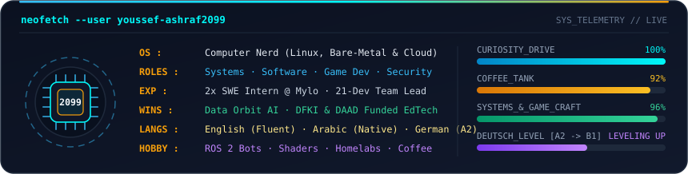

<div align="center">
  
  <br /><br />

  <!-- Quick-Jump Interactive Navigation Dock -->
  <a href="#sys-specs">
    
  </a>
  <a href="#nerd-console">
    
  </a>
  <a href="#tech-racks">
    
  </a>
  <a href="#telemetry">
    
  </a>
  <br />
  <a href="https://www.linkedin.com/in/youssef-ashraf-5a3167261/">
    
  </a>
  <a href="https://instagram.com/youssef2099x">
    
  </a>
  <a href="mailto:youssef.ashrafhilal@gmail.com">
    
  </a>
  
  
  
</div>

<div align="center">
  <br />
  
</div>

<a id="sys-specs"></a>

### 🖥️ System Specs & Nerd DNA

<div align="center">
  
</div>

<br />

> *"I'm a lifelong computer nerd who loves understanding the whole stack — from CPU registers, ROS 2 nodes, and Linux internals to game loops, scalable software, and security engineering."*

<table>
  <tr>
    <td width="50%" valign="top">
      <h4>⚡ What Fires Me Up</h4>
      <ul>
        <li><b>Systems Engineering</b> — <code>ROS 2</code> robotics graphs, <code>Linux</code> internals, <code>Raspberry Pi</code> tinkering, <code>C/C++</code>, <code>Rust</code>, <code>x86</code> &amp; <code>MIPS</code></li>
        <li><b>Software &amp; Cloud</b> — clean architectures, APIs, containers, and <code>Git</code> / <code>GitHub Actions</code> CI/CD automation</li>
        <li><b>Game Dev &amp; 3D</b> — building interactive worlds, mechanics &amp; real-time visuals in <code>Unity</code> and <code>Three.js</code></li>
        <li><b>Security &amp; Applied AI</b> — threat modeling, packet inspection, defensive tooling, and ML pipelines</li>
      </ul>
    </td>
    <td width="50%" valign="top">
      <h4>🏆 Milestones &amp; Human Languages</h4>
      <ul>
        <li>💻 <b>2x Software Engineering Intern @ Mylo</b> — returned twice to ship production features &amp; real-world systems</li>
        <li>👥 <b>Led a 21-Member Team</b> — architected and delivered a full corporate <b>HR System</b> end-to-end</li>
        <li>🤖 <b>Data Orbit Recognition</b> — recognized for building an innovative AI model</li>
        <li>🎓 <b>DFKI &amp; DAAD Funded</b> — built an EdTech platform recognized by DFKI and funded by DAAD</li>
        <li>🗣️ <b>Spoken Languages</b> — <code>English</code> (Fluent) · <code>Arabic</code> (Native) · <code>German</code> (A2)</li>
      </ul>
    </td>
  </tr>
</table>

<div align="center">
  
</div>

<a id="nerd-console"></a>

### ⌨️ Interactive Nerd Console

> *Click any terminal command below to inspect logs, projects, or diagnostics:*

<details>
  <summary><code>❯ cat /etc/youssef/computer_nerd.log</code> — <b>Why I'm obsessed with computers &amp; how I learn</b></summary>
  <br />

```yaml
identity:
  archetype: "Full-Stack Computer Nerd & Tech Enthusiast"
  motto: "If it has a CPU, a kernel, a shader, or a packet — let's open it up."
  languages:
    arabic: "Native"
    english: "Fluent"
    german: "A2 (actively leveling up toward B1)"
  rabbit_holes:
    - "Spinning up ROS 2 nodes, Linux configs, and Raspberry Pi homelab experiments"
    - "Writing low-level C/C++/Rust & peeking at x86/MIPS instructions"
    - "Prototyping gameplay feel & 3D scenes in Unity and Three.js"
    - "Automating repetitive tasks with Bash, Python, and GitHub Actions"
```

</details>

<details>
  <summary><code>❯ ls -la ~/experience_and_wins/</code> — <b>2x Mylo SWE, Leadership &amp; Awards</b></summary>
  <br />

| Role / Recognition | Organization | What I Did |
| :--- | :--- | :--- |
| **2x Software Engineering Intern** | **Mylo** | Returned for two internships shipping reliable production code, debugging complex flows, and collaborating across engineering teams. |
| **Engineering Team Lead (21 Members)** | **Corporate Client** | Led a 21-person multidisciplinary team to design, build, and deliver a complete HR System. |
| **AI Model Recognition** | **Data Orbit** | Designed and trained an innovative AI model recognized by Data Orbit. |
| **EdTech Platform Funding** | **DFKI &amp; DAAD** | Built an educational technology platform recognized by DFKI and funded by DAAD. |

</details>

<details>
  <summary><code>❯ ./explore_domains.sh --all</code> — <b>Systems · Software · Game Dev · Security</b></summary>
  <br />

- **🤖 Systems Engineering &amp; Robotics:** `ROS 2`, `Linux`, `Bash`, `Raspberry Pi`, `C`, `C++`, `Rust`, `x86`, `MIPS`
- **⚙️ Software, Cloud &amp; Automation:** `Go`, `Python`, `Java`, `Spring`, `C#`, `.NET`, `Django`, `NestJS`, `Express`, `Docker`, `Kubernetes`, `Git`, `GitHub Actions`, `AWS`
- **🎮 Game Dev &amp; Interactive 3D:** `Unity`, `Three.js`, `TypeScript`, `React`, `Next.js`
- **🛡️ Security Engineering &amp; AI:** `Nmap`, `Wireshark`, `Burp Suite`, `Metasploit`, `Cisco`, `PyTorch`, `TensorFlow`, `scikit-learn`

</details>

<div align="center">
  <br />
  
</div>

<a id="tech-racks"></a>

### 🧰 Animated Tech Racks

<div align="center">
  
  <br /><br />
  
  <br /><br />
  
  <br /><br />
  
</div>

<div align="center">
  <br />
  
</div>

<a id="telemetry"></a>

### 📡 Late-Night Telemetry

<div align="center">
  <!-- Contributions Over Time -->
  
  <br /><br />

  <!-- Stats + Late-Night Commit Hours (UTC+2) -->
  
  
  <br /><br />

  <!-- Most Used Programming Languages -->
  
  
  <br /><br />

  <!-- Streak Card -->
  
  <br /><br />

  <!-- Contribution Snake -->
  <picture>
    <source media="(prefers-color-scheme: dark)" srcset="https://raw.githubusercontent.com/Youssef-Ashraf2099/Youssef-Ashraf2099/output/github-contribution-grid-snake-dark.svg" />
    <source media="(prefers-color-scheme: light)" srcset="https://raw.githubusercontent.com/Youssef-Ashraf2099/Youssef-Ashraf2099/output/github-contribution-grid-snake.svg" />
    
  </picture>
  <br /><br />

  <details>
    <summary><code>❯ open ~/telemetry/github-metrics.svg</code> — <b>Full Isometric Calendar, 27 Languages &amp; Deep Metrics (Auto-Updated Daily)</b></summary>
    <br />
    
  </details>
</div>

<div align="center">
  <br />
  
</div>
